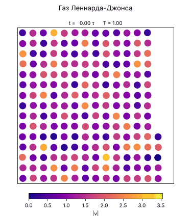
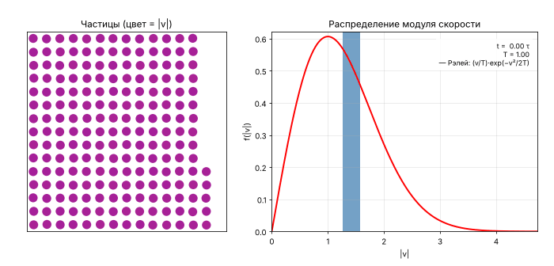
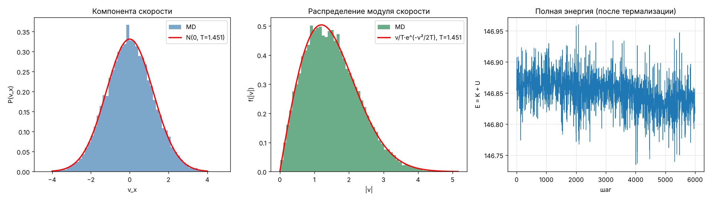
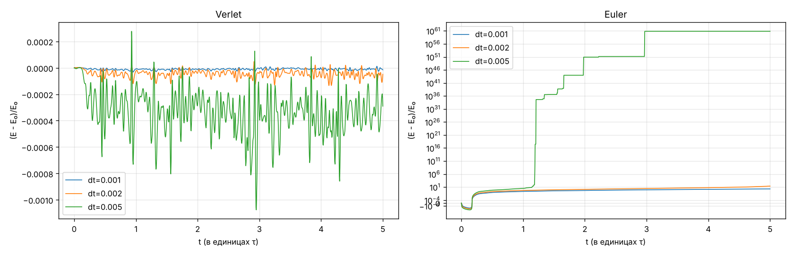
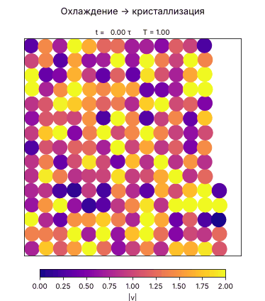

# Молекулярная динамика двумерного газа Леннарда-Джонса

Лабораторная работа №2 по курсу «Компьютерное моделирование» (МГТУ им. Н. Э. Баумана, кафедра СМ6).

**Тема:** интегрирование уравнений движения методом Верле и проверка распределения скоростей Максвелла (в 2D — распределения Рэлея).

<p align="center">
  
</p>

N = 200 частиц в квадратной ячейке с периодическими границами. Цвет частицы — модуль её скорости.

---

## Модель

**Потенциал Леннарда-Джонса** (безразмерные единицы: σ = ε = m = k<sub>B</sub> = 1):

$$
U(r) = 4\left[\left(\frac{1}{r}\right)^{12} - \left(\frac{1}{r}\right)^{6}\right], \qquad r < r_c = 2.5
$$

Потенциал обрезается на расстоянии $r_c$ и сдвигается на $U(r_c)$, чтобы энергия не имела скачка.

**Сила**, действующая на частицу $i$ со стороны $j$:

$$
\mathbf{F}_{ij} = \frac{24}{r^2}\left[2\left(\frac{1}{r}\right)^{12} - \left(\frac{1}{r}\right)^{6}\right]\mathbf{r}_{ij}
$$

**Интегрирование — скоростной метод Верле:**

$$
\mathbf{r}(t+\Delta t) = \mathbf{r}(t) + \mathbf{v}(t)\Delta t + \tfrac12\mathbf{a}(t)\Delta t^2, \qquad
\mathbf{v}(t+\Delta t) = \mathbf{v}(t) + \tfrac12\left[\mathbf{a}(t) + \mathbf{a}(t+\Delta t)\right]\Delta t
$$

**Граничные условия** — периодические, расстояния считаются по соглашению о ближайшем образе.

**Температура** в 2D после удаления импульса центра масс (2N − 2 степеней свободы): $T = K/(N-1)$.

---

## Результаты

### Релаксация к равновесному распределению

Старт со *всех одинаковых* по модулю скоростей. За несколько единиц времени τ распределение расплывается и выходит на распределение Рэлея — двумерный аналог распределения Максвелла:

$$
f(v) = \frac{v}{T}\exp\left(-\frac{v^2}{2T}\right)
$$

<p align="center">
  
</p>

### Равновесное распределение скоростей

После термализации компонента скорости распределена по Гауссу, а модуль — по Рэлею. Статистика Колмогорова–Смирнова D ≈ 0.006.

<p align="center">
  
</p>

### Сохранение энергии: Верле vs Эйлер

Относительный дрейф полной энергии за одинаковое физическое время 5τ. У метода Верле энергия колеблется на уровне ~10⁻⁴ при всех шагах dt. У явного метода Эйлера энергия растёт уже при малых dt, а при dt = 0.005 метод неустойчив.

<p align="center">
  
</p>

### Охлаждение → кристаллизация

При плотности ρ = 0.75 скорости медленно уменьшаются (×0.999 каждые 10 шагов). Частицы собираются в гексагональную упаковку — плотнейшую упаковку на плоскости.

<p align="center">
  
</p>

---

## Установка

```bash
python -m venv .venv
.venv\Scripts\activate          # Windows
pip install -r requirements.txt
```

## Запуск

Графики и анимации сохраняются в `results/`.

```bash
# Расчёт и графики
python -m lj_md.model --mode all                 # всё сразу
python -m lj_md.model --mode maxwell --n 200 --rho 0.3 --T 1.0 --steps 20000
python -m lj_md.model --mode euler               # сравнение Верле и Эйлера
python -m lj_md.model --mode relax               # релаксация распределения

# Анимации
python -m lj_md.animate --what all               # все GIF
python -m lj_md.animate --what particles         # движение частиц
python -m lj_md.animate --what relax             # релаксация к Рэлею
python -m lj_md.animate --what cool              # кристаллизация
```

## Тесты

```bash
pytest -v
```

Что проверяется:

- сила при r = 1 равна 24, при r = 2<sup>1/6</sup> — нулю;
- сила совпадает с численной производной −dU/dr;
- каждая пара частиц учитывается один раз;
- третий закон Ньютона: сумма всех сил равна нулю;
- ближайший образ: частицы взаимодействуют через границу ячейки;
- суммарный импульс равен нулю и сохраняется при интегрировании;
- корректность определения температуры и расчёта кадров анимации.

## Структура проекта

```
lj_md/
├── model.py      модель: силы, интеграторы, прогон МД, графики, CLI
└── animate.py    расчёт кадров и GIF-анимации (celluloid)
tests/            тесты pytest
docs/img/         иллюстрации для README
results/          результаты расчётов (не коммитятся)
```

## Технологии

Python · NumPy · Matplotlib · SciPy · celluloid · pytest
